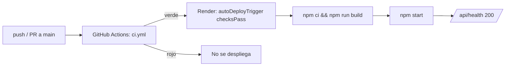

# Configuración CD — Render + GitHub Actions

Decisiones: Q1 = Render, Q2 = código de acceso + límite por IP, Q3 = push a `main` con CI en GitHub Actions (`deployment-pipeline-questions.md`). Repositorio GitHub público `reto-01-agente-proveedor`, rama `main`.

## Flujo



Texto: push o PR a `main` dispara `ci.yml`; Render solo despliega el commit de `main` cuando los checks de GitHub pasan; build `npm ci && npm run build`, arranque `npm start`, health check `/api/health`.

## `.github/workflows/ci.yml` (a crear)

```yaml
name: ci
on:
  push:
    branches: [main]
  pull_request:
    branches: [main]
permissions:
  contents: read
jobs:
  verificar:
    runs-on: ubuntu-latest
    timeout-minutes: 15
    steps:
      - uses: actions/checkout@v4
      - uses: actions/setup-node@v4
        with:
          node-version: 24
          cache: npm
      - run: npm ci
      - run: npm run typecheck
      - run: npm run lint
      - run: npx vitest run
      - run: npm run build
      - run: npm run demo
        env:
          FECHA_REFERENCIA: "2026-09-03"
```

Sin secretos en CI: ninguna prueba llama al modelo.

## `render.yaml` (Blueprint, a crear en la raíz)

```yaml
services:
  - type: web
    name: reto-01-agente-proveedor
    runtime: node
    plan: free
    branch: main
    autoDeployTrigger: checksPass
    buildCommand: npm ci && npm run build
    startCommand: npm start
    healthCheckPath: /api/health
    envVars:
      - key: NODE_VERSION
        value: "24"
      - key: ANTHROPIC_API_KEY
        sync: false
      - key: CLAVE_ACCESO
        sync: false
      - key: LLM_MODELO
        value: claude-sonnet-5-5
      - key: LLM_TIMEOUT_MS
        value: "60000"
      - key: MAX_ITERACIONES
        value: "25"
      - key: MAX_TOKENS_SESION
        value: "200000"
      - key: LIMITE_PETICIONES_MINUTO
        value: "20"
```

- `sync: false`: Render pide el valor al crear el servicio; nunca vive en el repo.
- `PORT` lo inyecta Render; `src/server.ts` ya lo lee.
- `npm ci` instala devDependencies (no se define `NODE_ENV=production`): `tsx` y `vite` se necesitan en build y arranque.
- Disco efímero: `out/` y `out/sesiones/` se pierden al reiniciar; aceptable (sin base de datos por PRD §3.2).

## Cambios de código necesarios antes del primer despliegue

**Estado: construidos y verificados en el Bolt 3.5** (229/229 pruebas, `ci.yml` y `render.yaml` idénticos a este documento; ver `construction/code-generation/code-summary.md` y `construction/build-and-test/test-results.md`). Riesgo abierto: confirmar en Render qué valor de `x-forwarded-for` agrega su proxy.

Detalle de lo construido:

| Cambio | Detalle |
|---|---|
| Código de acceso (Q2) | Middleware Hono en `/api/chat` y `/api/sessions/*` que exige header `x-clave-acceso` igual a `CLAVE_ACCESO` (comparación en tiempo constante); sin `CLAVE_ACCESO` definida (local) no exige nada. `/api/health` queda público. Front: pantalla que pide el código una vez, lo guarda en `sessionStorage` y lo envía en cada llamada; 401 → vuelve a pedirlo |
| Límite por IP (Q2) | `LIMITE_PETICIONES_MINUTO` (20) por IP en `/api/chat`, ventana deslizante en memoria; IP desde `x-forwarded-for` (Render pone proxy); 429 con mensaje claro en español |
| `engines` | `"engines": { "node": ">=20" }` en `package.json` |
| Archivos | `.github/workflows/ci.yml`, `render.yaml` como arriba; `.env.example` + `CLAVE_ACCESO=`, `LIMITE_PETICIONES_MINUTO=20` |
| Pruebas | 401 sin código / 200 con código / health sin código; 429 al pasar el límite; front pide el código |

## Matriz de promoción

| Entorno | Disparo | Gate | URL |
|---|---|---|---|
| Local | `npm run dev` | — | `http://localhost:5173` |
| CI | push/PR a `main` | typecheck, lint, 189 pruebas, build, demo | — |
| Producción (Render) | commit en `main` con checks verdes | CI verde + health check `/api/health` | `https://reto-01-agente-proveedor.onrender.com` (el nombre exacto lo asigna Render) |

Un solo entorno desplegado (reto de selección): no hay staging. Feature flags: no aplican.

## Seguridad

- Secretos (`ANTHROPIC_API_KEY`, `CLAVE_ACCESO`) solo en el panel de Render; nunca en repo, front, logs ni CI.
- El código de acceso protege el gasto de la clave; no es autenticación de usuarios (fuera de alcance, PRD §3.2). Va en el README como pide el PRD §6.1.
- `permissions: contents: read` en el workflow; sin tokens de despliegue en GitHub (Render observa el repo con su GitHub App).
